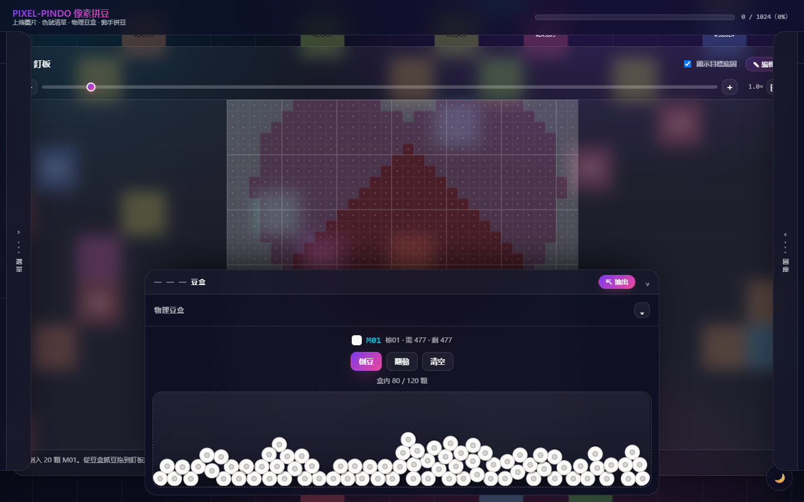

# pixel-pindo 像素拼豆

**線上拼豆模擬工作台** — 上傳一張圖，轉成 192 色標準色號圖紙，再用物理豆盒一顆顆把豆子拼上去。

不是「上傳圖片產生像素圖」那麼簡單：它把**線下拼豆的完整流程**搬到瀏覽器裡 —— 先看圖紙知道要買哪些顏色的豆、各幾顆；再從豆盒裡抓豆、拖到釘板上、一格格拼完。



> 純前端、零依賴、零建置。雙擊 `index.html` 就能跑，不上傳任何圖片到伺服器。

---

## 立即試用

```bash
# 方式一：直接開
雙擊 index.html

# 方式二：本地伺服器（推薦，避免個別瀏覽器對 file:// 的限制）
python -m http.server 8765 --bind 127.0.0.1
# 開啟 http://127.0.0.1:8765
```

沒有圖片？點左側抽屜的 **「使用內建示範圖案（32×32 愛心）」** 直接體驗完整流程。

---

## 它解決什麼問題

真實拼豆有兩個痛點：

1. **不知道要買多少豆** —— 看圖憑感覺買，拼到一半缺色
2. **拼的過程很枯燥** —— 想先試試效果，但豆子一放下就要重來

這個工具把兩件事接起來：先算出精確的購豆清單，再用可逆的數位釘板模擬拼豆過程。

---

## 核心功能

### 圖片 → 色號圖紙
上傳任意圖片，自動降採樣並對映到內建 **192 色標準色卡**（16 色系 × 12 深淺階，色號 `A01`–`P12`）。

色差比對用 **redmean 加權距離**（比純 RGB 歐氏距離更接近人眼感知），避免選到肉眼看起來差很多的顏色。

### 想拼局部？直接在釘板上框選
釘板格子有限，不必遷就整張圖。點右上角 **`✎ 編輯`**，在釘板上拖曳框出要保留的範圍，按「套用」就依該區域重新生成 —— 框多大，格子就多大。

### 物理豆盒
用 **Matter.js** 模擬真實豆盒：重力、碰撞、堆疊、可抓取翻找。豆子是中空圓筒造型，堆疊後有自然的錯落感。

- 豆盒可以**抽出成浮動小窗**，邊看圖紙邊取豆
- 浮窗可自由縮放，最小尺寸依豆子數量自動計算（豆子多 → 盒子不能太小）
- 盒內活體豆上限 120 顆，倒豆時分批落入

### 即時進度統計
每一色即時顯示 **需求 / 已放 / 剩餘**。放錯顏色會閃黃框提示並用紅圈標記，但不阻擋你 —— 允許試錯，只是不計入完成度。

### 購豆清單匯出
一鍵匯出 JSON，直接拿去買豆：

```json
{
  "size": { "width": 40, "height": 40 },
  "progress": { "demandTotal": 1600, "correctTotal": 0, "remaining": 1600, "percent": 0 },
  "colors": [
    { "code": "A08", "name": "紅08", "hex": "#DB2480", "demand": 400, "remaining": 400 }
  ]
}
```

### 圖片庫
上傳過的圖片自動存進瀏覽器 **IndexedDB**（關掉瀏覽器也還在）。可載入、複製、刪除，載入時連當初框選的區域與尺寸一起還原。

---

## 介面：三個抽屜，中間留給釘板

```
┌─────────────────────────────────────────────────┐
│  頂欄：品牌 + 總進度條                            │
├──────┬───────────────────────────────┬──────────┤
│ 左屜 │                               │ 右屜     │
│ 選單 │          釘　板                │ 圖片庫   │
│ 上傳 │   縮放 / 平移 / 框選編輯        │ 載入     │
│ 色號 │                               │ 複製     │
│ 清單 │                               │ 刪除     │
├──────┴───────────────────────────────┴──────────┤
│  底部屜：物理豆盒（可抽出成浮動小窗）              │
└─────────────────────────────────────────────────┘
```

三個抽屜都是**半常駐**：收起時只露出一條 44px 拉柄，點擊或拖曳即可展開。可以同時打開，互不干擾；`Esc` 一次全收。

介面留白優先給釘板 —— 最乾淨的狀態下，整個畫面只有釘板。

---

## 技術亮點

| 項目 | 做法 |
|------|------|
| **零依賴** | 無 npm、無 CDN、無建置流程。唯一的第三方庫 Matter.js 已下載到 `vendor/` |
| **file:// 直開** | 全部用傳統 `<script>` 標籤，不用 ES module（避免 CORS 限制） |
| **物理穩定性** | resize 時先凍結豆子再夾回邊界、每幀兜底越界檢查、牆體加厚防穿透 |
| **縮放座標反算** | 任意縮放／平移狀態下，滑鼠位置都能精確對應到格子 |
| **Canvas 尺寸一致性** | 強制 canvas 的 CSS 尺寸等於物理世界尺寸，避免非等比例拉伸（豆子變橢圓） |
| **離線可用** | 圖片只在瀏覽器本機處理，IndexedDB 儲存，無網路請求 |

### 192 色卡怎麼來的

以 HSL 規則確定性生成：16 個色系（紅、粉紅、橙、黃、黃綠、草綠、綠、青、天藍、藍、紫、紫紅、棕、米膚、黑白灰、深色系）× 12 個亮度階。

- 極淺色降低飽和，避免螢光感
- 非灰色系保留最低 12% 飽和度，避免退化成灰色而與黑白灰系重複
- `O01` 直接給純白 `#FFFFFF`，確保白色圖底命中

---

## 專案結構

```
.
├── index.html              入口
├── data/
│   └── color-card.js       192 色標準卡
├── scripts/
│   ├── config.js           全域參數（網格 / 物理 / 縮放）
│   ├── color-diff.js       RGB↔HEX、redmean 色差、最近色
│   ├── image-processor.js  圖片載入、像素化、色卡對映
│   ├── inventory.js        需求 / 已放 / 剩餘統計
│   ├── physics-box.js      Matter.js 豆盒（重力、碰撞、堆疊）
│   ├── image-store.js      IndexedDB 圖片庫
│   ├── board.js            釘板渲染、縮放平移、框選
│   ├── background.js       宇宙光暈 + 網格動畫 + 主題
│   ├── cropper.js          舊版彈窗裁切器（保留未啟用）
│   └── app.js              主控：串接模組與 UI
├── styles/
│   └── main.css            樣式（暗色玻璃 + 淺色主題）
├── vendor/
│   └── matter.min.js       Matter.js 0.20.0
├── docs/
│   ├── 功能說明.md          各功能詳細說明
│   ├── 變更記錄.md          開發歷程與修正紀錄
│   └── screenshot.png      介面截圖
└── tests/
    ├── unit-test.js        單元測試
    └── resource-check.js   資源存在性檢查
```

---

## 開發

```bash
# 單元測試
node tests/unit-test.js        # 54 / 54 通過

# 資源檢查
node tests/resource-check.js   # 13 / 13 存在
```

### 調整參數

大部分行為集中在 `scripts/config.js`：

```js
GRID:    { DEFAULT: 40, MIN: 8, MAX: 128 }        // 網格尺寸
PHYSICS: { BEAD_RADIUS: 13, GRAVITY_Y: 0.7, ... } // 豆盒物理
BOARD:   { ZOOM_MIN: 0.5, ZOOM_MAX: 8, ... }      // 釘板縮放
```

### 換成自家色卡

改 `data/color-card.js` 的 `FAMILIES`（色系與色相）與 `LIGHTNESS`（亮度階），或整份換成商家提供的色卡陣列，格式為 `{ code, name, hex, rgb }`。

---

## 授權

MIT

## 致謝

- [Matter.js](https://brm.io/matter-js/) — 2D 物理引擎
